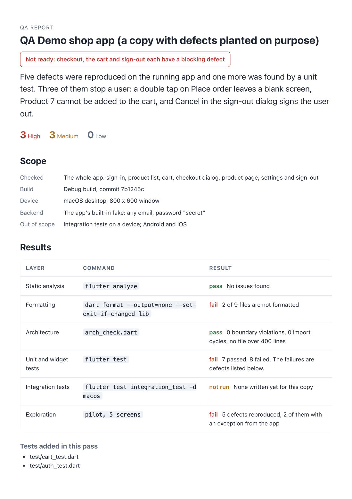
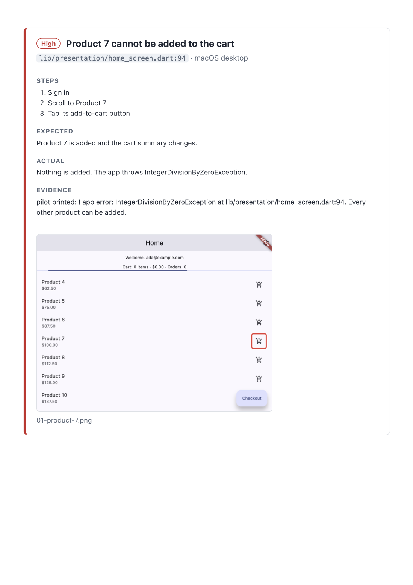

# flutter-qa

**Hand Claude Code your Flutter app. Get back a QA report with every defect
framed in a screenshot, as HTML and PDF.**

[](https://github.com/ahsanrazapk/flutter-qa/actions/workflows/test.yml)
[](LICENSE)

<p>
  
  
</p>

Six skills that make Claude Code test a Flutter app the way a QA engineer
would: drive the running app, write the unit, widget and integration tests
that are missing, review the architecture, and say plainly what is left for a
person. They use **only the Flutter SDK**: no Maestro, Appium or Patrol, no
cloud service, no API key, and nothing added to your `pubspec.yaml`.

## Does it find bugs?

Six defects were planted in a copy of the example app. An agent was given that
copy and these skills, and nothing about what was broken. In one run of 29
tool calls it reported all six, and two more that had not been planted:

| Defect | How it was found |
|---|---|
| A double tap on Place order places two orders and leaves a blank screen | `pilot tap --double` in a saved flow, and a unit test |
| One product cannot be added to the cart (division by zero) | unit and widget tests |
| Cancel in the sign-out dialog signs the user out | reading the code |
| No discount at exactly $100.00 (off by one) | a unit test on the rule's boundary |
| Sign-in spins for ever when the failure is not a wrong password | a unit test for the unexpected error |
| The rating control breaks screen readers | a widget test |
| *Not planted:* an empty cart can be ordered | a unit test |
| *Not planted:* signing out leaves the cart filled | reading the code |

The report in the pictures above comes from that same copy:
[sample-report.pdf](docs/sample-report.pdf) ·
[sample-report.html](docs/sample-report.html) (download and open).

This is one run on one small app with Claude Sonnet: a demonstration, not a
benchmark. The agent also left part of the exploration undone, and said so in
its report, which is what the skills ask for.

## Install

In Claude Code:

```
/plugin marketplace add ahsanrazapk/flutter-qa
/plugin install flutter-qa@flutter-qa
```

Or from a shell:

```
claude plugin marketplace add ahsanrazapk/flutter-qa
claude plugin install flutter-qa@flutter-qa
```

You need Claude Code and a Flutter SDK on your `PATH`. For phones, the Android
SDK or Xcode that Flutter already needs. For the PDF, any of Chrome, Chromium,
Edge or Brave; without one you still get the HTML.

## Say this

Open Claude Code in your Flutter project and ask in your own words:

```
QA the checkout feature and give me the report.
Run my app on the emulator, sign in with the test account and check the cart total.
Double tap every button on the payment screen and tell me what breaks.
Write unit tests for CartBloc, including the failure paths.
Why does my login widget test time out in pumpAndSettle?
Turn the sign-up flow into an integration test.
Review this app's architecture and state management.
```

## What you get

| Skill | Claude uses it when you ask to |
|---|---|
| `running-flutter-qa` | QA an app, a feature or a pull request and get a report |
| `driving-flutter-apps` | open the app, click through a flow, check a screen, reproduce a bug |
| `testing-flutter-logic` | unit test business rules and state management (Bloc, Riverpod, Provider, GetX, plain notifiers) |
| `testing-flutter-ui` | widget test screens: Material, Cupertino, custom-painted; accessibility; goldens |
| `testing-flutter-flows` | write and run end-to-end tests with `integration_test` |
| `reviewing-flutter-architecture` | review layering, state management, error handling and testability |

Three tools come with the skills, each one plain Dart file with no
dependencies:

- **`pilot`** drives a debug build on an emulator, simulator, device or
  desktop. It reads the screen as a list of elements, each with the widget and
  **source line** that created it; taps, double taps, long presses, types and
  scrolls with real pointer events; waits for widgets instead of sleeping;
  refuses to tap what a user could not reach; replays saved flows; frames a
  faulty element in a screenshot; and reports every exception the app throws
  along the way. It keeps working when a desktop app's window is hidden behind
  your editor.
- **`arch_check`** finds imports that cross layer boundaries, import cycles
  between features, oversized files, and test coverage per module, including
  files no test ever loads.
- **`qa_report`** turns the findings into one HTML page with the screenshots
  embedded, and a PDF of it.

### What driving an app looks like

Real output, from the example app in this repo:

```
$ pilot start -d macos
ready
$ pilot snapshot
screen 800x600  route / (MaterialPageRoute<dynamic>)
[9] header "Sign in"  <- Text lib/presentation/login_screen.dart:39
[5] textfield "Email"  <- TextFormField key=email lib/presentation/login_screen.dart:48
[6] textfield "Password" (obscured)  <- TextFormField key=password lib/presentation/login_screen.dart:56
[7] button "Sign in"  <- FilledButton key=sign_in lib/presentation/login_screen.dart:70
$ pilot type "ada@example.com" --key email --quiet
ok: TextFormField key=email lib/presentation/login_screen.dart:48 at 400,96
$ pilot type "wrong" --key password --quiet
ok: TextFormField key=password lib/presentation/login_screen.dart:56 at 400,144
$ pilot tap --key sign_in
ok: FilledButton key=sign_in lib/presentation/login_screen.dart:70 at 400,200
screen 800x600  route / (MaterialPageRoute<dynamic>)
[9] header "Sign in"  <- Text lib/presentation/login_screen.dart:39
[5] textfield "Email" = "ada@example.com"  <- TextFormField key=email lib/presentation/login_screen.dart:48
[6] textfield "Password" = "•••••" (obscured)  <- TextFormField key=password lib/presentation/login_screen.dart:56
[11] button "Sign in"  <- FilledButton key=sign_in lib/presentation/login_screen.dart:70
[12] text "Invalid credentials"  <- Text lib/presentation/login_screen.dart:78
```

Each line is an element on screen, the widget your code created for it, its
key, and the source line. Every action says what it landed on and prints the
screen that follows. If the app throws while a command runs, the exception and
its source line are printed too:

```
! app error: IntegerDivisionByZeroException  at lib/presentation/home_screen.dart:94
```

### Saved flows

A flow replays in seconds and fails on the first broken step or app exception,
with a screenshot of the widget that step was aimed at:

```
# pilot/checkout.flow
restart
type "ada@example.com" --key email
type "${QA_DEMO_PASSWORD}" --key password
tap --key sign_in
wait --contains "Welcome"
scroll-to --text "Product 30"
tap --tooltip "Add Product 30"
tap --key checkout
wait --text "Total $348.75"
```

### Framed screenshots

```
pilot shot qa-report/01.png --key place_order           # frame a widget
pilot shot qa-report/02.png --src lib/cart.dart:57      # frame the widget an error names
```

`pilot` is `dart <plugin>/skills/driving-flutter-apps/scripts/pilot.dart`; run
it with no arguments for every command. It works without Claude too.

## What it does not do

- **Release builds.** Pilot needs a debug build. Performance, obfuscation and
  store checks stay manual.
- **Native UI.** Permission prompts, web views, maps, payments and push
  notifications are outside Flutter's widget tree. The skills grant or avoid
  them with `adb` and `xcrun simctl`, and list the rest as manual checks.
- **Flutter web**, and widgets with integer or object keys in `--key`.
- **Judgement.** Whether it looks and feels right is still a person's call.
- On Windows, `pilot start` prints the `flutter run` command to launch
  yourself, and hot reload by signal is unavailable.

Every report ends with a "Not covered" section for exactly this reason, and
the report generator refuses a report where that section is empty.

## Example app and self-tests

`example/` is a small shop app (Material, Cupertino and a canvas-drawn widget)
with unit, widget, golden and integration tests. The plugin's own tests run
against it:

```
sh tool/selftest.sh          # unit and widget tests
sh tool/selftest.sh macos    # plus a live session, two flows and the integration test
```

Built and tested with Flutter 3.47 on macOS: the full self-test on a macOS
desktop target, and a live session on an Android 16 emulator. The unit and
widget tests also run on Linux in CI. Not yet run on an iOS simulator or on
Windows.

## License

MIT
